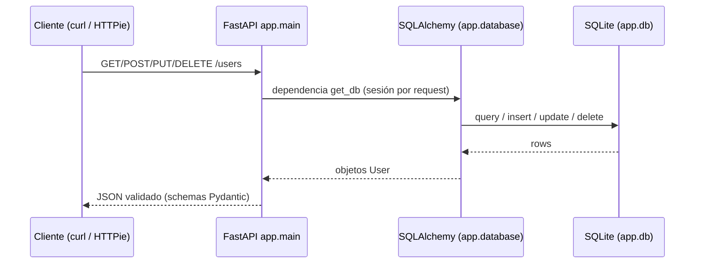

# fast-api-demo

API didáctica con FastAPI y SQLite: CRUD completo de usuarios con validaciones, Swagger/ReDoc automático y descripción lista para enseñar. Incluye Docker, SQLAlchemy y pruebas.

[](https://python.org)
[](https://fastapi.tiangolo.com/)
[](https://www.sqlalchemy.org/)
[](https://www.docker.com/)
[](https://github.com/bi0punk/fast-api-demo/actions)
[](LICENSE)

## Contenido

- [Características](#características)
- [Arquitectura](#arquitectura)
- [Stack](#stack)
- [Estructura del repositorio](#estructura-del-repositorio)
- [Instalación](#instalación)
- [Uso](#uso)
- [Endpoints](#endpoints)
- [Ejemplos con curl](#ejemplos-con-curl)
- [Ejemplos con HTTPie](#ejemplos-con-httpie)
- [Docker](#docker)
- [SQLite](#revisar-sqlite)
- [Configuración](#configuración)
- [Tests / CI](#tests--ci)
- [Roadmap](#roadmap)
- [Licencia](#licencia)

## Características

- **CRUD completo**: crear, listar, obtener, actualizar y eliminar usuarios
- **Documentación automática**: Swagger UI + ReDoc
- **Validaciones**: Pydantic schemas con tipos y constraints
- **SQLAlchemy ORM**: base de datos SQLite con creación automática de tablas
- **Docker listo**: imagen optimizada
- **Script de pruebas**: `scripts_test.sh` para testeo automatizado con curl

## Arquitectura



Flujo: el cliente interactúa con los routers de FastAPI; cada request abre una sesión SQLAlchemy a la base de datos SQLite `app.db` y las respuestas se validan con schemas Pydantic.

## Stack

| Componente | Tecnología |
|---|---|
| Framework | FastAPI 0.110+ |
| ORM | SQLAlchemy 2.0+ |
| DB | SQLite |
| Validación | Pydantic 2.0+ |
| Servidor | Uvicorn |
| Contenedor | Docker |
| Testing | pytest + httpx |

## Estructura del repositorio

```
fast-api-demo/
├── app/
│   ├── __init__.py
│   ├── main.py              # FastAPI app + endpoints raíz
│   ├── database.py          # SQLAlchemy engine + session
│   ├── models.py            # Modelo User (SQLAlchemy)
│   ├── schemas.py           # Schemas Pydantic
│   └── routers/
│       ├── __init__.py
│       └── users.py         # CRUD de usuarios
├── tests/
├── Dockerfile
├── docker-compose.yml
├── scripts_test.sh          # Pruebas automatizadas con curl
├── app.db                   # SQLite DB (creada al ejecutar)
├── .env / .env.example
├── .github/workflows/ci.yml
├── pyproject.toml
├── requirements.txt
└── README.md
```

## Instalación

Requisitos: Python 3.11+ y pip.

```bash
git clone https://github.com/bi0punk/fast-api-demo.git
cd fast-api-demo
python3 -m venv venv
source venv/bin/activate
pip install -r requirements.txt
```

## Uso

```bash
uvicorn app.main:app --reload --host 0.0.0.0 --port 8000
```

- Swagger UI: [http://localhost:8000/docs](http://localhost:8000/docs)
- ReDoc: [http://localhost:8000/redoc](http://localhost:8000/redoc)

## Endpoints

| Método | Ruta | Descripción |
|---|---|---|
| GET | `/` | Endpoint raíz |
| GET | `/health` | Healthcheck |
| GET | `/users/` | Listar usuarios |
| GET | `/users/{id}` | Obtener usuario |
| POST | `/users/` | Crear usuario |
| PUT | `/users/{id}` | Actualizar usuario |
| DELETE | `/users/{id}` | Eliminar usuario |

## Ejemplos con curl

### Healthcheck

```bash
curl http://localhost:8000/health
```

### Crear usuario

```bash
curl -X POST http://localhost:8000/users/ \
  -H "Content-Type: application/json" \
  -d '{"name": "Juan Perez", "email": "juan@example.com", "age": 30}'
```

### Listar usuarios

```bash
curl http://localhost:8000/users/
```

### Obtener usuario

```bash
curl http://localhost:8000/users/1
```

### Actualizar usuario

```bash
curl -X PUT http://localhost:8000/users/1 \
  -H "Content-Type: application/json" \
  -d '{"age": 31}'
```

### Eliminar usuario

```bash
curl -X DELETE http://localhost:8000/users/1
```

## Ejemplos con HTTPie

```bash
http POST :8000/users/ name="Ana Torres" email="ana@example.com" age:=25
http GET :8000/users/
http PUT :8000/users/1 age:=26
http DELETE :8000/users/1
```

## Tests / CI

CI: GitHub Actions ejecuta lint (Ruff) y tests (pytest) en cada push/PR a main/master.

```bash
pip install pytest httpx
pytest tests/ -v
```

### Pruebas con curl script

```bash
chmod +x scripts_test.sh
./scripts_test.sh    # Requiere API levantada
```

## Docker

```bash
docker compose up --build
```

## Revisar SQLite

```bash
sqlite3 app.db
```

```sql
.tables
SELECT * FROM users;
.exit
```

## Configuración

Variables de entorno (ver `.env.example`):

| Variable | Default | Descripción |
|---|---|---|
| `DATABASE_URL` | `sqlite:///app.db` | URL de conexión SQLite |

## Roadmap

- [x] CRUD usuarios con FastAPI + SQLAlchemy
- [x] Documentación Swagger/ReDoc automática
- [ ] Autenticación JWT
- [ ] Paginación en listados
- [ ] Filtros por campos
- [ ] Migraciones con Alembic
- [ ] Soporte PostgreSQL (multi-DB)
- [ ] Pruebas de integración con base de datos de prueba

## Licencia

MIT — ver [LICENSE](LICENSE).